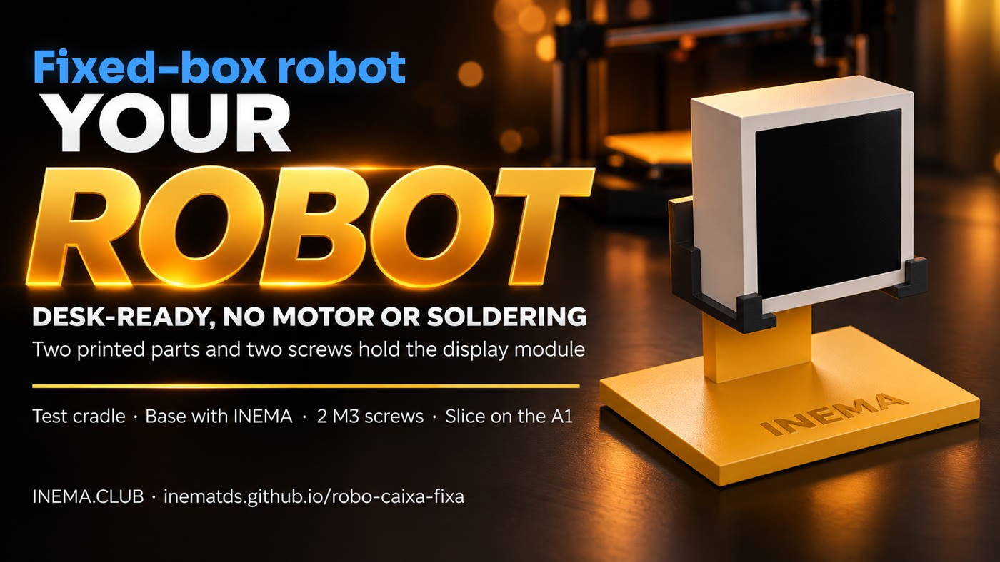

# Robô caixa fixa

**[Português](README.md) · [English](README.en.md) · [Español](README.es.md)**

## What it is

Anyone who wants a desktop robot often runs into the mechanical side: servos, gears, and wires. Robô caixa fixa is a 3D-printed stand that turns the Waveshare ESP32-S3 module with a 1.54-inch display into a fixed head on a base. The module stays whole, with its factory case and electronics. You need a 3D printer, Bambu Studio, filament, the module, and two screws with nuts. The design was checked on a computer, but has not been printed yet. The face on the display and the AI conversation do not exist yet: this guide covers the stand only.

## Guide and downloads

**https://linnoff88-dev.github.io/arckhe-/guia/en/**

The guide includes the STL files, a ZIP package, a 3D assembly, checks, and slicing instructions for the A1. Start with the cradle. The files are for study and have not yet been physically validated; there is no G-code or validated 3MF profile.

## The process, start to finish

Who does what: 🧠 session with Nei · ⚙️ script · 🤖 `claude -p`.

1. ⚙️ Generate the parts and verification: `../robos-impressos/.venv/bin/python cad/gerar.py` (writes to `estudo/`).
2. 🧠 Copy the STL, GLB, and `verificacao.json` files from `estudo/` to `guia/downloads/` and rebuild the test ZIP, only when the geometry changes.
3. ⚙️ Export the assembled parts for rendering: `../robos-impressos/.venv/bin/python scripts/exporta_partes.py <pasta>`.
4. ⚙️ Render the guide images in Blender (CPU, ~25 min): `blender -b -P scripts/render_guia.py -- <pasta> <saida>`; convert them to `guia/assets/r-*.jpg` and `r-orto-*.webp`.
5. 🧠 PT/EN/ES banners via Codex (`gerar-banner.sh` from the projetos-landing-guia skill, live and grade styles), using the assembled render as a shape reference; check the text on each one.
6. 🧠 Write the PT guide (`guia/index.html`); ⚙️ translate it into `guia/en/` and `guia/es/` with `ARCKHÉ-traduz`.
7. 🤖 Independent review; check at 360 px, the images, and the 3D viewer over local HTTP.
8. 🧠 Nei’s OK, commit, and push; GitHub Pages publishes automatically.
9. 🧠 Physical test of the cradle on the A1 (pending) before releasing the final STL files.

## Project files

- [Physical project](PROJETO-FISICO.md) (in Portuguese).
- [Definition and variants](DEFINICAO.md) (in Portuguese).
- [CAD generator](cad/gerar.py).
- [Verification](estudo/verificacao.json).

Two parts and two M3 × 16 screws with nuts, to be checked at the workbench. ARCKHÉ is embossed 1.2 mm, thickened and recessed by 4 mm. The face program and AI are planned for a future stage.
## Project video

https://www.youtube.com/watch?v=BEY94Ag9BWk
