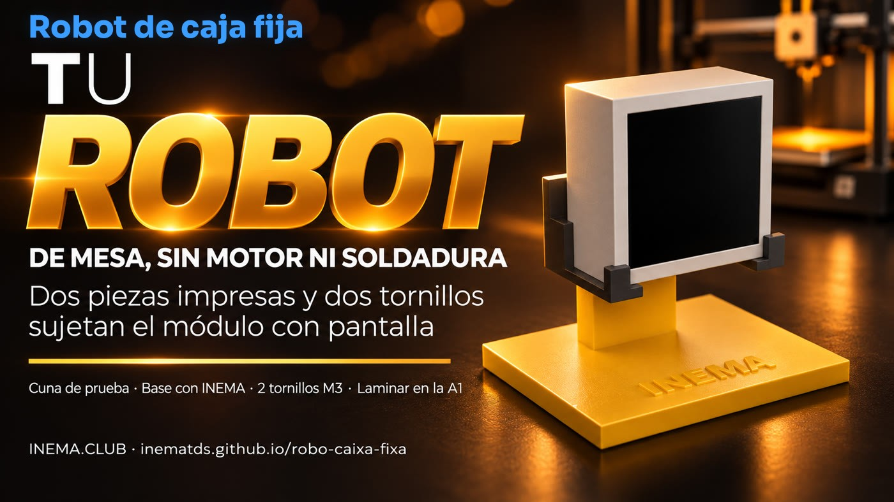

# Robô caixa fixa

**[Português](README.md) · [English](README.en.md) · [Español](README.es.md)**

## Qué es

Quienes quieren un robot de escritorio suelen encontrarse con la parte mecánica: servos, engranajes y cables. Robô caixa fixa es un soporte impreso en 3D que convierte el módulo Waveshare ESP32-S3 con pantalla de 1,54 pulgadas en una cabeza fija sobre una base. El módulo queda completo, con su carcasa y electrónica de fábrica. Necesitas una impresora 3D, Bambu Studio, filamento, el módulo y dos tornillos con tuercas. El diseño se revisó en la computadora, pero aún no se imprimió. La cara en la pantalla y la conversación con IA todavía no existen: esta guía cubre solo el soporte.

## Guía y descargas

**https://inematds.github.io/robo-caixa-fixa/guia/es/**

La guía incluye los STL, el paquete ZIP, el montaje 3D, las verificaciones y los pasos para laminar con la A1. Empieza por la cuna. Los archivos son prototipos de estudio y todavía no se han validado físicamente; no hay G-code ni un perfil 3MF validado.

## El proceso, de principio a fin

Quién hace qué: 🧠 sesión con Nei · ⚙️ script · 🤖 `claude -p`.

1. ⚙️ Generar las piezas y la verificación: `../robos-impressos/.venv/bin/python cad/gerar.py` (guarda en `estudo/`).
2. 🧠 Copiar los archivos STL, GLB y `verificacao.json` de `estudo/` a `guia/downloads/` y rehacer el ZIP de prueba, solo cuando cambie la geometría.
3. ⚙️ Exportar las piezas ensambladas para renderizar: `../robos-impressos/.venv/bin/python scripts/exporta_partes.py <pasta>`.
4. ⚙️ Renderizar las imágenes de la guía en Blender (CPU, ~25 min): `blender -b -P scripts/render_guia.py -- <pasta> <saida>`; convertirlas a `guia/assets/r-*.jpg` y `r-orto-*.webp`.
5. 🧠 Banners PT/EN/ES con Codex (`gerar-banner.sh` de la skill projetos-landing-guia, estilos live y grade), usando el render del conjunto como referencia de forma; revisar el texto de cada uno.
6. 🧠 Escribir la guía PT (`guia/index.html`); ⚙️ traducirla a `guia/en/` y `guia/es/` con `inema-traduz`.
7. 🤖 Revisión independiente; comprobar a 360 px, las imágenes y el visor 3D por HTTP local.
8. 🧠 OK de Nei, commit y push; GitHub Pages publica automáticamente.
9. 🧠 Prueba física del soporte en la A1 (pendiente) antes de liberar los archivos STL finales.

## Archivos del proyecto

- [Proyecto físico (en portugués)](PROJETO-FISICO.md).
- [Definición y variantes (en portugués)](DEFINICAO.md).
- [Generador CAD](cad/gerar.py).
- [Verificación](estudo/verificacao.json).

Dos piezas y dos tornillos M3 × 16 con tuercas, por verificar en el banco de trabajo. INEMA en relieve de 1,2 mm, con letras engrosadas y retraídas 4 mm. El programa para el rostro y la IA quedan para una etapa futura.

## Vídeo del proyecto

https://www.youtube.com/watch?v=BEY94Ag9BWk
