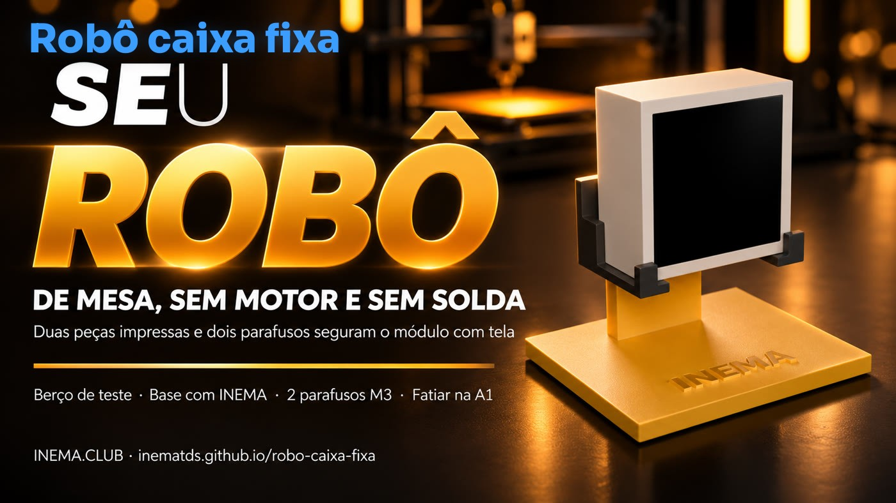

# RobêƒÂ´ caixa fixa

  
  
<strong>Arckhé AI</strong>

**[PortuguêƒÂªs](README.md) ê‚· [English](README.en.md) ê‚· [EspaêƒÂ±ol](README.es.md)**

## O que êƒÂ©

Quem quer um robêƒÂ´ de mesa costuma esbarrar na parte mecêƒÂ¢nica: servos, engrenagens e fios. O RobêƒÂ´ caixa fixa êƒÂ© um suporte impresso em 3D que transforma o mêƒÂ³dulo Waveshare ESP32-S3 com tela de 1,54 polegadas numa cabeêƒÂ§a fixa sobre uma base. O mêƒÂ³dulo fica inteiro, com carcaêƒÂ§a e eletrêƒÂ´nica de fêƒÂ¡brica. VocêƒÂª precisa de uma impressora 3D, do Bambu Studio, de filamento, do mêƒÂ³dulo e de dois parafusos com porca. O desenho foi conferido no computador, mas ainda nêƒÂ£o foi impresso. O rosto na tela e a conversa por IA ainda nêƒÂ£o existem: este guia cobre sêƒÂ³ o suporte.

## Guia e downloads

**https://inematds.github.io/robo-caixa-fixa/guia/**

O guia tem os STL, pacote ZIP, montagem 3D, verificaêƒÂ§êƒÂµes e passo a passo de fatiamento para a A1. Comece pelo berêƒÂ§o. Os arquivos sêƒÂ£o de estudo e ainda nêƒÂ£o foram validados fisicamente; nêƒÂ£o hêƒÂ¡ G-code nem perfil 3MF validado.

## O processo, do inêƒÂ­cio ao fim

Quem faz: ê°Å¸Â§Â  sessêƒÂ£o com o Nei ê‚· ê¢Å¡â„¢ê¯Â¸Â script ê‚· ê°Å¸Â¤â€“ `claude -p`.

1. ê¢Å¡â„¢ê¯Â¸Â Gerar as peêƒÂ§as e a verificaêƒÂ§êƒÂ£o: `../robos-impressos/.venv/bin/python cad/gerar.py` (grava `estudo/`).
2. ê°Å¸Â§Â  Copiar STL, GLB e `verificacao.json` de `estudo/` para `guia/downloads/` e refazer o ZIP de teste, sêƒÂ³ quando a geometria mudar.
3. ê¢Å¡â„¢ê¯Â¸Â Exportar as peêƒÂ§as montadas para o render: `../robos-impressos/.venv/bin/python scripts/exporta_partes.py <pasta>`.
4. ê¢Å¡â„¢ê¯Â¸Â Renderizar as imagens do guia no Blender (CPU, ~25 min): `blender -b -P scripts/render_guia.py -- <pasta> <saida>`; converter para `guia/assets/r-*.jpg` e `r-orto-*.webp`.
5. ê°Å¸Â§Â  Banners PT/EN/ES pelo Codex (`gerar-banner.sh` da skill projetos-landing-guia, estilos live e grade), com o render do conjunto como referêƒÂªncia de forma; conferir o texto de cada um.
6. ê°Å¸Â§Â  Escrever o guia PT (`guia/index.html`); ê¢Å¡â„¢ê¯Â¸Â traduzir para `guia/en/` e `guia/es/` com `inema-traduz`.
7. ê°Å¸Â¤â€“ Revisor independente; conferir 360 px, imagens e visualizador 3D por HTTP local.
8. ê°Å¸Â§Â  OK do Nei, commit e push; o GitHub Pages publica sozinho.
9. ê°Å¸Â§Â  Teste fêƒÂ­sico do berêƒÂ§o na A1 (pendente) antes de liberar STL finais.

## Arquivos do projeto

- [Projeto fêƒÂ­sico](PROJETO-FISICO.md).
- [DefiniêƒÂ§êƒÂ£o e variantes](DEFINICAO.md).
- [Gerador CAD](cad/gerar.py).
- [VerificaêƒÂ§êƒÂ£o](estudo/verificacao.json).

Duas peêƒÂ§as e dois parafusos M3 êƒâ€” 16 com porcas, a conferir na bancada. INEMA em relevo de 1,2 mm, engrossado e recuado 4 mm. Programa do rosto e IA ficam para uma etapa futura.

## VêƒÂ­deo do projeto

https://www.youtube.com/watch?v=BEY94Ag9BWk

---

  
  
<strong>Arckhé AI</strong>

